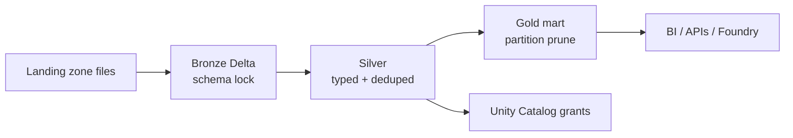

# Lakehouse blueprints

Public patterns I use when moving batch estates onto **Databricks**, **Delta Lake**, and **Unity Catalog**.

This is teaching code, not John Deere source. It shows how I structure bronze / silver / gold pipelines, catalog grants, data-quality gates, and the Spark knobs that moved cost and runtime in production.



## Why these files exist

| Path | Intent |
| --- | --- |
| `pipelines/bronze_ingest.py` | Land files into Delta with a locked schema (`FAILFAST`, no mergeSchema) |
| `pipelines/silver_conform.py` | Typed business grain, drop duplicates |
| `pipelines/gold_mart.py` | Consumption table shaped for partition pruning |
| `quality/checks.py` | Fail the job if grain, nulls, or freshness break |
| `governance/unity_grants.sql` | Catalog / schema / table grants for a Hive → UC cutover |
| `ops/cluster_notes.md` | Cluster sizing and Spark knobs that actually moved cost |

The same shape ports to Databricks Jobs and Palantir Foundry transforms.

## Run locally

```bash
python -m pip install pyspark delta-spark
python -m py_compile pipelines/*.py quality/*.py
```

Full Spark execution needs a local Spark session or a Databricks workspace. The modules are written to be imported from a job, not as a demo notebook dump.

## Production lessons encoded here

1. Lock bronze schema. Schema drift belongs in an explicit contract, not `mergeSchema true`.
2. Deduplicate on business grain in silver, not in every gold query.
3. Partition on the column jobs filter, never on a high-cardinality ID.
4. Size the cluster to shuffle, then freeze autoscaling for SLA jobs.
5. Put grants in Unity Catalog so access is reviewable.
